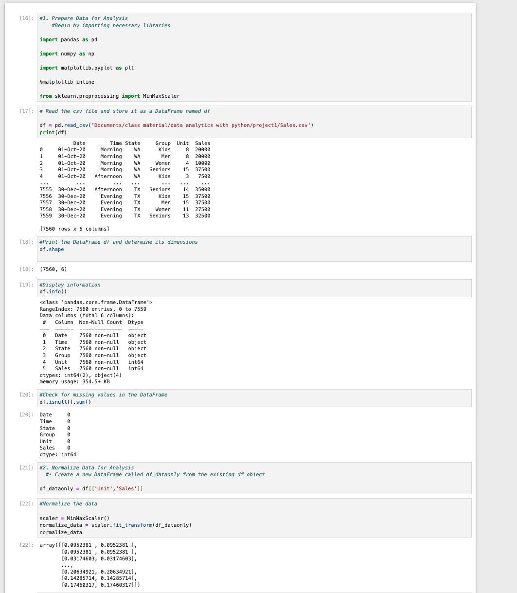
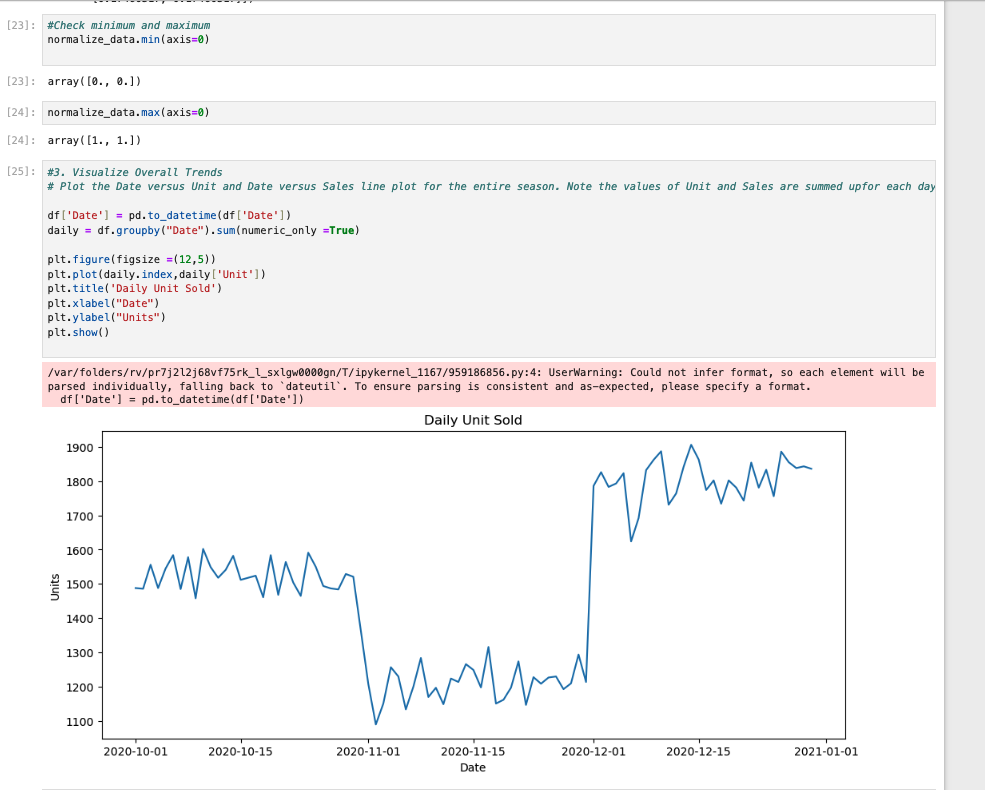
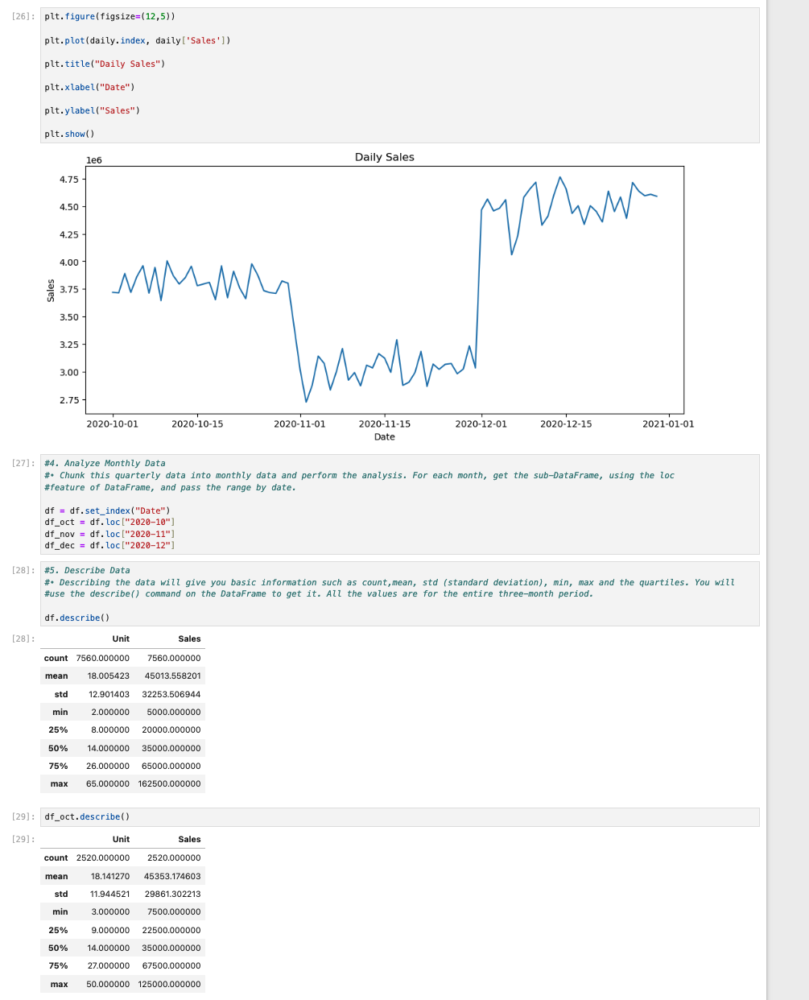
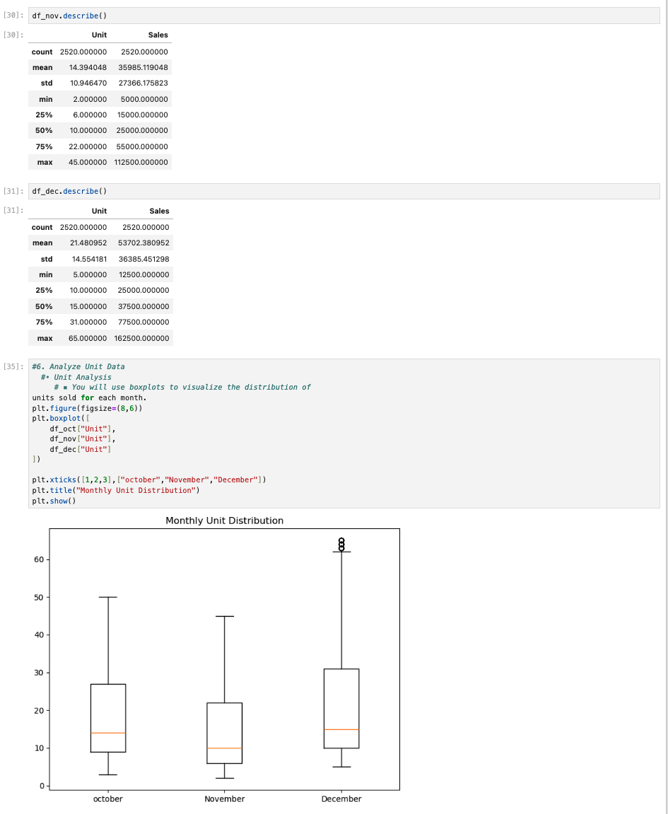
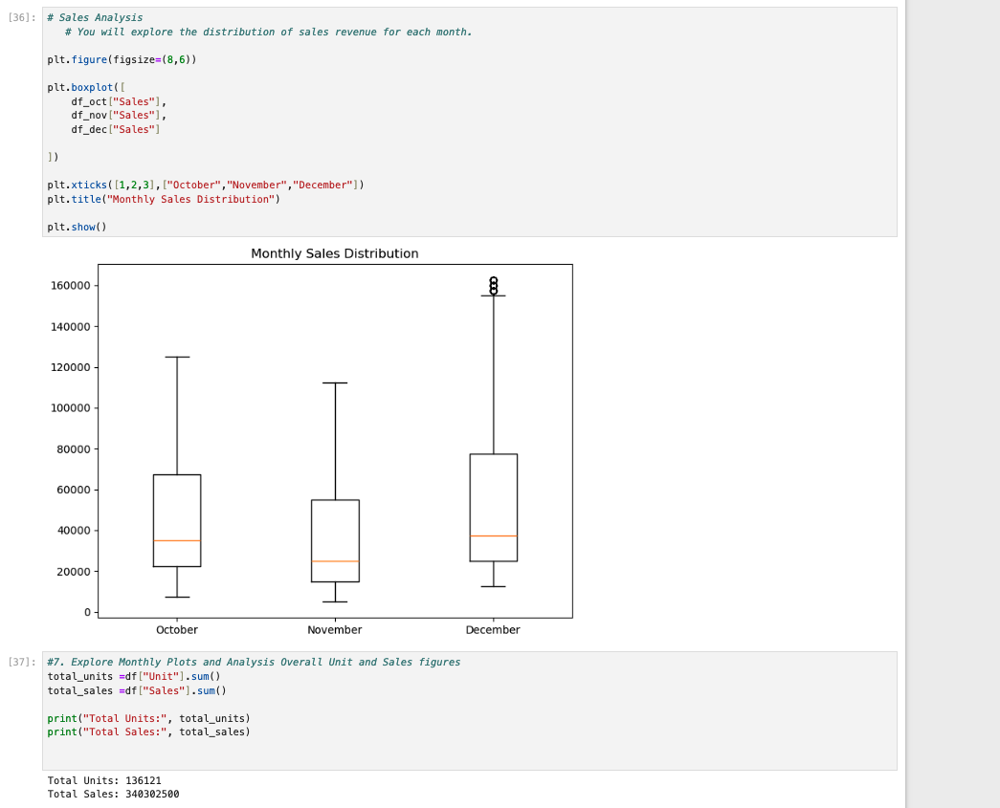
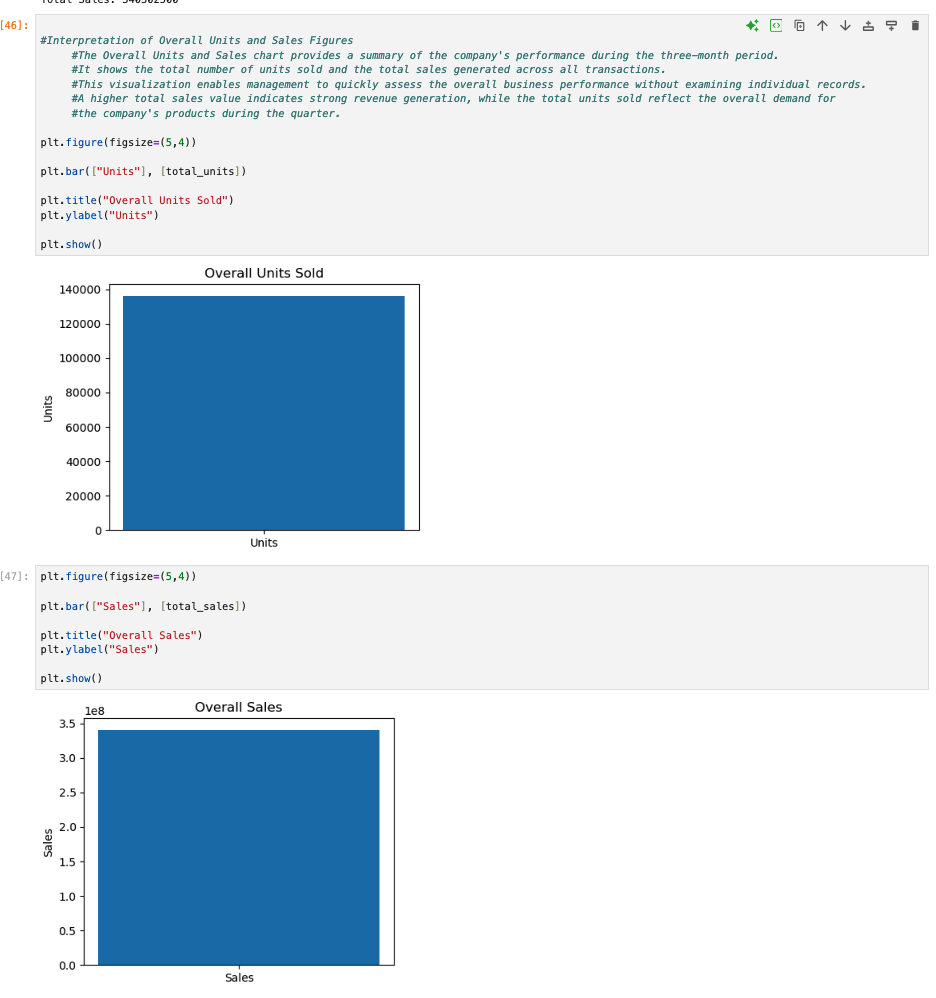
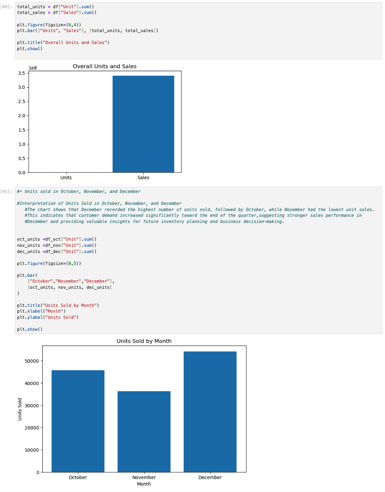
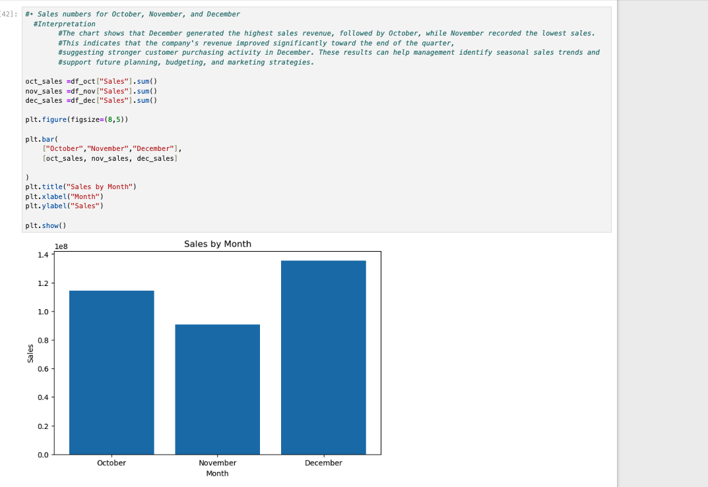
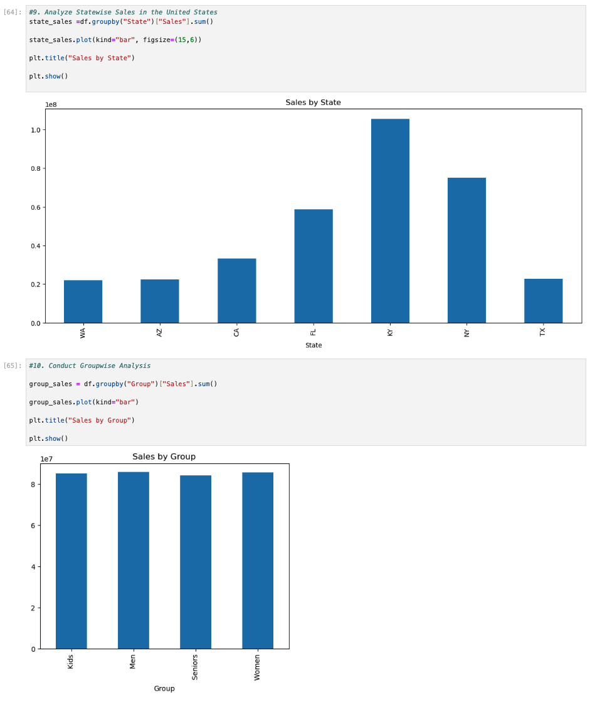
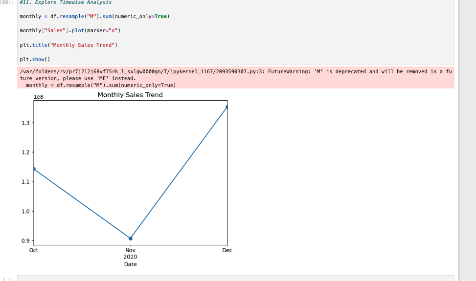

# 📈 Retail Sales Analysis (Python)


[← Back to portfolio](../../README.md)


---

## 📌 Project Overview

I analyzed **7,560 sales transactions from Q4 2020 (October to December)** for a retail company using **Python in a Jupyter Notebook**. The analysis looks at how sales and units move by **day, month, state and customer group**, so management can plan inventory and marketing for the busiest periods.

## 🎯 Business Questions

- How did sales and units change across the quarter?
- Which month performed best, and which performed worst?
- Which states generate the most and the least revenue?
- Do some customer groups (Kids, Men, Women, Seniors) buy much more than others?

## 📂 Dataset

**`Sales.csv`**: 7,560 rows and 6 columns, with **no missing values**.

| Column | Description |
|--------|-------------|
| `Date` | Transaction date (1 Oct – 30 Dec 2020) |
| `Time` | Time of day: Morning, Afternoon or Evening |
| `State` | 7 states: WA, AZ, CA, FL, KY, NY, TX |
| `Group` | Customer group: Kids, Men, Women, Seniors |
| `Unit` | Units sold |
| `Sales` | Sales value. In this dataset each unit equals 2,500 in sales |

---

## 🔧 How It Was Built

| Step | What was done | Code |
|------|---------------|------|
| **1. Prepare** | Loaded the CSV and checked its shape, data types and missing values | `pd.read_csv`, `df.shape`, `df.info()`, `df.isnull().sum()` |
| **2. Normalize** | Scaled `Unit` and `Sales` to a 0–1 range and confirmed the min and max | `MinMaxScaler().fit_transform()` |
| **3. Daily trends** | Converted dates, summed by day and plotted daily units and daily sales | `pd.to_datetime`, `groupby("Date").sum()` |
| **4. Monthly split** | Set `Date` as the index and sliced out October, November and December | `set_index`, `df.loc["2020-10"]` |
| **5. Describe** | Summary statistics for the full quarter and for each month | `describe()` |
| **6. Distributions** | Box plots of units and sales by month | `plt.boxplot` |
| **7. Monthly totals** | Bar charts of units and sales by month, a consolidated daily sales line and an executive summary | `sum()`, `plt.bar`, `plt.plot` |
| **8. State & group** | Total sales by state and by customer group | `groupby("State")`, `groupby("Group")` |
| **9. Time series** | Monthly resample of sales | `resample("M").sum()` |

---

## 📊 Results

### Executive Summary

| Metric | Value |
|--------|-------|
| Total sales | **340,302,500** |
| Total units sold | **136,121** |
| Average sale per transaction | 45,013.56 |
| Average units per transaction | 18.01 |
| Highest / lowest single sale | 162,500 / 5,000 |

### Monthly Breakdown

| Month | Sales | Units | Avg. units per transaction |
|-------|------:|------:|------:|
| October | 114,290,000 | 45,716 | 18.1 |
| November | 90,682,500 | 36,273 | 14.4 |
| **December** | **135,330,000** | **54,132** | **21.5** |

*Monthly totals = mean × transaction count (2,520 per month) from each month's `describe()` output. They add up exactly to the quarter totals.*

## 💡 Key Insights

1. **December was the strongest month:** sales were **49% higher than November** and **18% higher than October**. Daily sales jumped at the start of December and stayed high all month.
2. **November was the weakest month.** Daily sales fell sharply on 1 November and stayed low for the whole month, before recovering on 1 December. This points to a seasonal dip that is worth planning promotions around.
3. **December has the widest spread of order sizes.** It is the only month with outliers in the box plots (up to 65 units and 162,500 in a single transaction).
4. **KY is the top state by a clear margin**, followed by NY and FL. **WA, AZ and TX are the lowest**, each well below KY. Low-performing states are candidates for targeted marketing.
5. **Sales are split almost evenly across Kids, Men, Women and Seniors**, so no customer group is being under-served.

<details>
<summary><b>📸 View all notebook screenshots</b></summary>

#### Data loading, checks & normalization


#### Daily units sold


#### Daily sales & summary statistics


#### Monthly statistics & unit distribution


#### Sales distribution & totals


#### Overall units and sales


#### Units by month


#### Sales by month


#### Sales by state & by group


#### Monthly sales trend


</details>

## 📁 Files

| File | Description |
|------|-------------|
| [`notebook/sales_analysis.ipynb`](notebook/sales_analysis.ipynb) | Full Jupyter Notebook with code, outputs, charts and interpretations (renders on GitHub) |
| [`docs/Sales_Analysis_Report.docx`](docs/Sales_Analysis_Report.docx) | Step-by-step project report |
| [`screenshots/`](screenshots/) | Notebook screenshots |

## ▶️ How to Run

```bash
pip install pandas numpy matplotlib scikit-learn jupyter
jupyter notebook notebook/sales_analysis.ipynb
```

Before running, change the path in the `pd.read_csv(...)` cell so it points to your copy of `Sales.csv`.

[← Back to portfolio](../../README.md)
