# 🎯 Marketing Campaign Analysis (Python)


[← Back to portfolio](../../README.md)

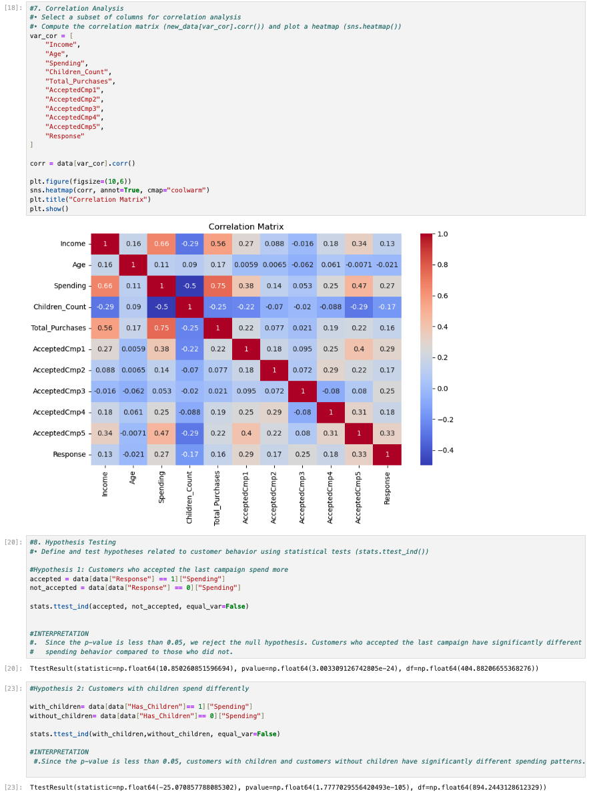

---

## 📌 Project Overview

I analyzed **2,240 customers** of a retail company to understand **who responds to marketing campaigns and what drives their spending**.

The notebook covers the full analytics workflow:

**cleaning → missing-value imputation → feature engineering → outlier treatment → encoding → correlation → hypothesis testing → visualization**

## 🎯 Business Questions

- Do customers who accept a campaign spend more, and do they earn more?
- How does having children affect spending?
- Which products bring in the most revenue?
- Which age groups and countries respond best to campaigns?
- What is the educational background of customers who complain?

## 📂 Dataset

**`marketing_data.csv`**: 2,240 customers and 28 columns.

| Category | Fields |
|----------|--------|
| **Profile** | ID, Year_Birth, Education, Marital_Status, Income, Kidhome, Teenhome, Country |
| **Engagement** | Dt_Customer (enrollment date), Recency, Complain |
| **Spending (by product)** | MntWines, MntFruits, MntMeatProducts, MntFishProducts, MntSweetProducts, MntGoldProds |
| **Purchases (by channel)** | NumDealsPurchases, NumWebPurchases, NumCatalogPurchases, NumStorePurchases, NumWebVisitsMonth |
| **Campaigns** | AcceptedCmp1–5, Response (accepted the last campaign) |

---

## 🔧 How It Was Built

| Step | What was done |
|------|---------------|
| **1. Fix data types** | Removed the extra spaces in the `Income` column name, stripped `$` and `,` and converted Income to a float. Parsed `Dt_Customer` as a date |
| **2. Clean categories** | Merged the Marital_Status values `Alone`, `YOLO` and `Absurd` into `Single` |
| **3. Impute missing values** | Filled the **24 missing Income values** with the mean income of customers who share the same Education and Marital Status (`groupby().transform()`). Any remaining gaps got the overall mean |
| **4. Feature engineering** | Created `Age`, `Spending` (sum of the 6 product columns), `Total_Purchases` (sum of the 4 channels), `Children_Count` and a binary `Has_Children` |
| **5. Distributions** | Histograms and box plots of Income, Spending, Age and Total_Purchases |
| **6. Outlier treatment** | IQR method: capped values outside Q1 − 1.5×IQR and Q3 + 1.5×IQR with `np.clip()`. This keeps every customer instead of dropping rows |
| **7. Encoding** | **Ordinal encoding** for Education (Basic → PhD). **One-hot encoding** for Country and Marital_Status |
| **8. Correlation** | Heatmap of 11 variables: income, age, spending, children, purchases and all campaign responses |
| **9. Hypothesis testing** | Three **Welch's t-tests** (`stats.ttest_ind`, `equal_var=False`) at α = 0.05 |
| **10. Visualization** | Product spending, age-group response, response by country, children vs spending, complaints by education, income vs spending |

---

## 📊 Results

### Hypothesis Tests (Welch's t-test, α = 0.05)

| # | Hypothesis | t-statistic | p-value | Result |
|---|------------|------------:|--------:|--------|
| H1 | Customers who accepted the last campaign spend a different amount | 10.85 | 3.0 × 10⁻²⁴ | ✅ Significant: **responders spend more** |
| H2 | Customers with children spend a different amount | −25.07 | 1.8 × 10⁻¹⁰⁵ | ✅ Significant: **customers with children spend less** |
| H3 | Campaign responders have a different income | 6.72 | 5.2 × 10⁻¹¹ | ✅ Significant: **responders earn more** |

### Strongest Correlations

| Variables | r |
|-----------|---:|
| Spending ↔ Total_Purchases | 0.75 |
| Income ↔ Spending | 0.66 |
| Income ↔ Total_Purchases | 0.56 |
| Spending ↔ Children_Count | −0.50 |
| Spending ↔ AcceptedCmp5 | 0.47 |

## 💡 Key Insights

1. **Wine is the top product by far**, with **680,816** in total spending. **Meat products are second at 373,968**. Together they make up most of all product spending, so they should lead promotions.
2. **Higher-income customers spend more.** Income correlates strongly with spending (r = 0.66), and customers who accepted the last campaign have a significantly higher income (H3).
3. **Children reduce spending.** Spending falls as the number of children rises (r = −0.50), and the gap is highly significant (H2). Family-focused bundles could close part of that gap.
4. **Spain (SP) has by far the most customers who accepted the last campaign**, more than three times the next country (SA). Spain's campaign approach could be a model for other markets.
5. **Customers aged 30–39 had the highest acceptance rate for Campaign 5**, followed by those aged 70+. *(Age was calculated as the current year minus the birth year.)*
6. **21 customers complained.** Most of them (14) have a Graduation-level education, followed by 2n Cycle (4), Master (2) and PhD (1).

<details>
<summary><b>📸 View all notebook screenshots</b></summary>

#### Data loading & missing values
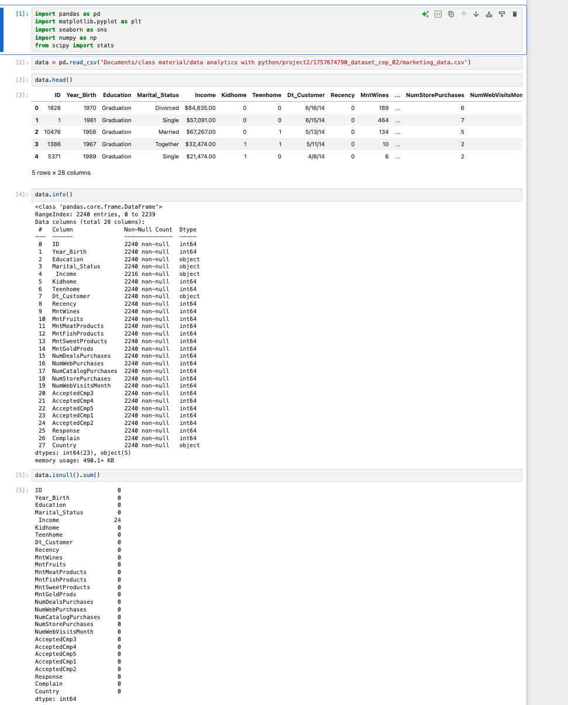

#### Summary statistics & income cleaning
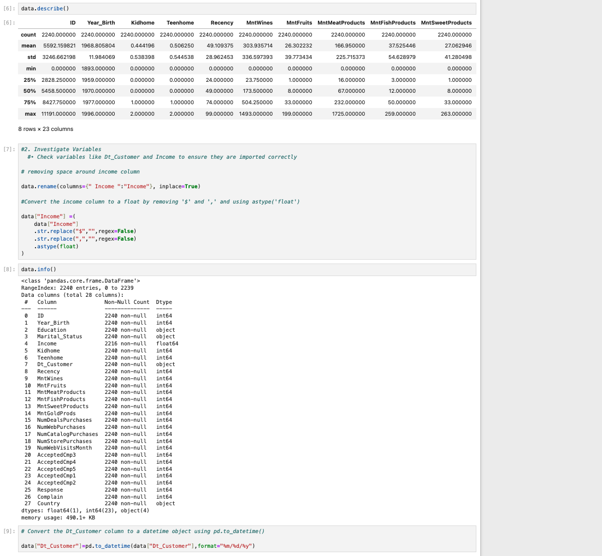

#### Imputation & feature engineering
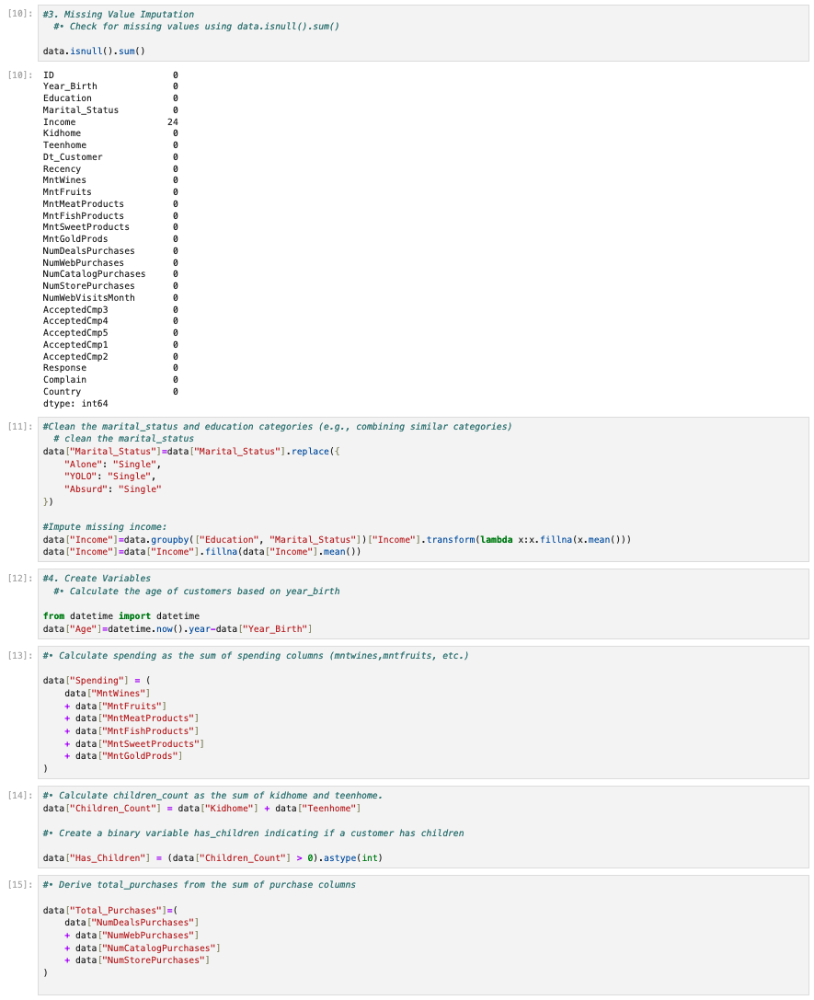

#### Distributions: Income & Spending
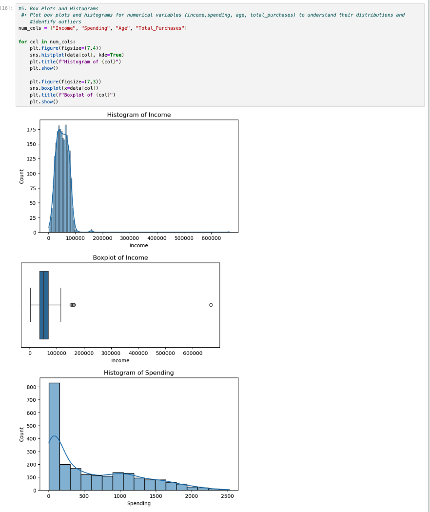

#### Distributions: Age & Total Purchases
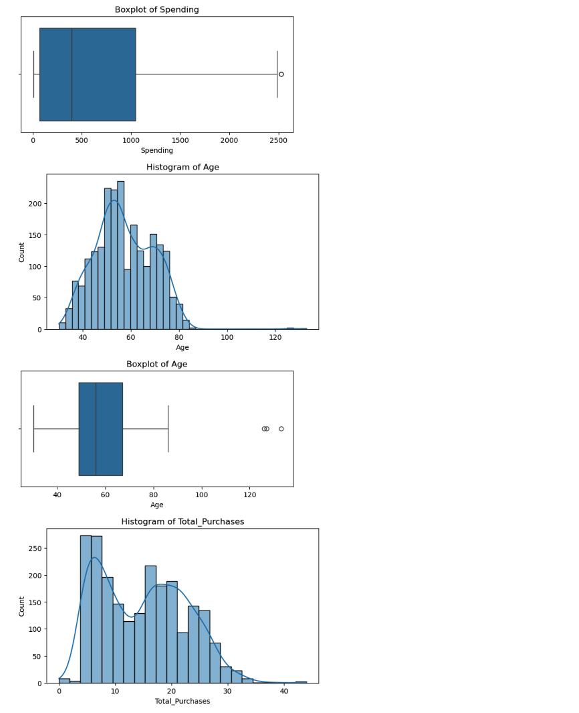

#### Outlier capping (IQR)
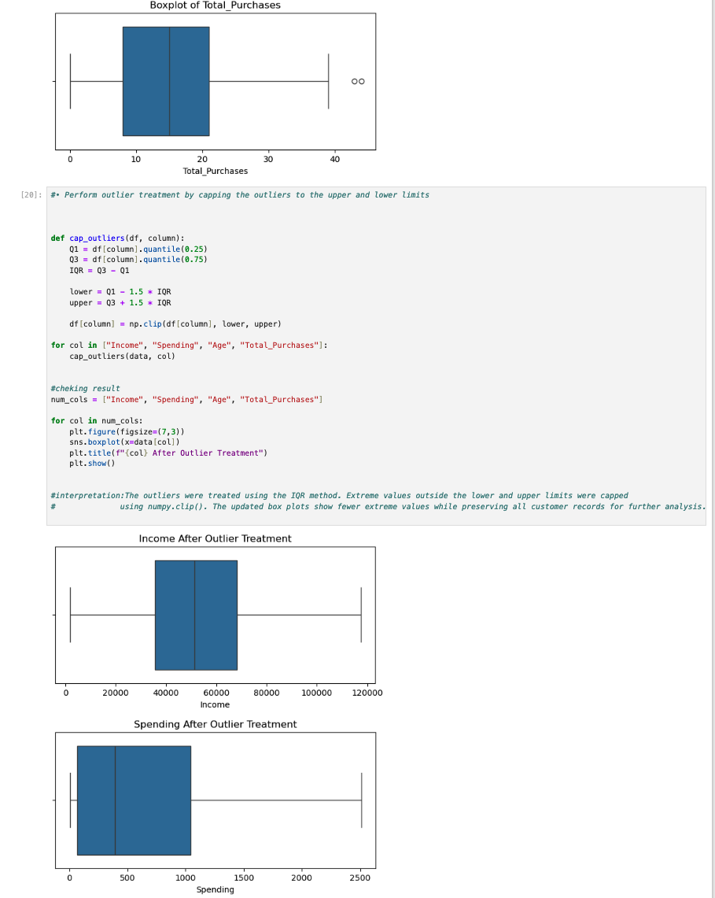

#### Encoding
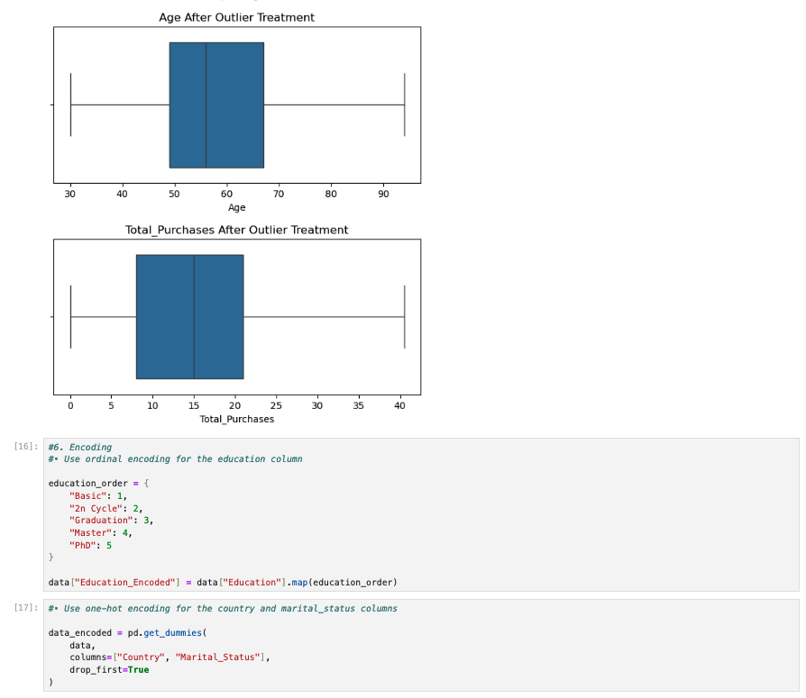

#### Income hypothesis test & product spending
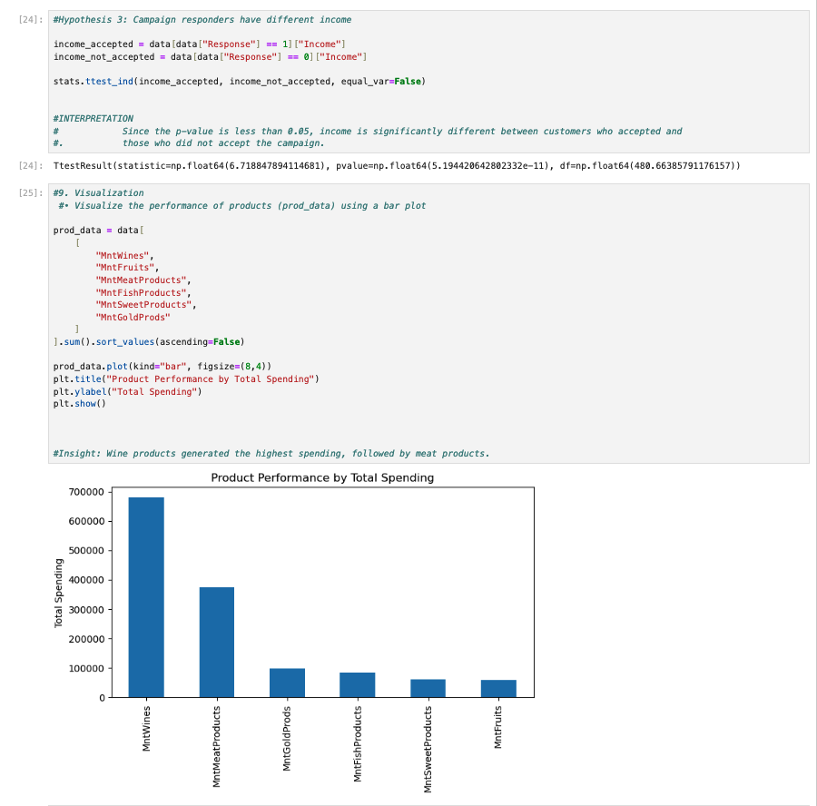

#### Age group & country response
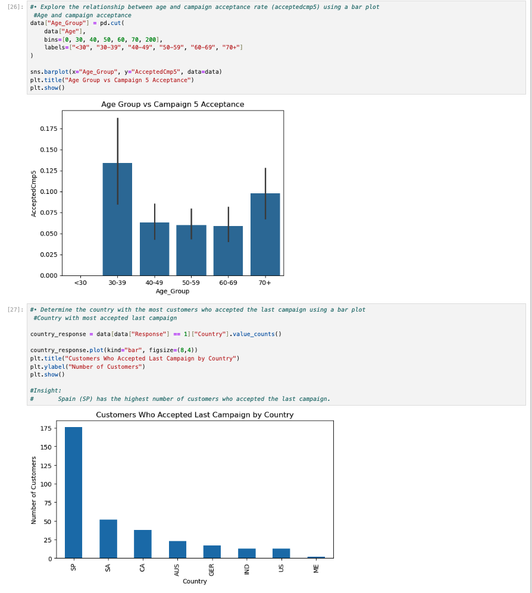

#### Children vs spending & complaints by education
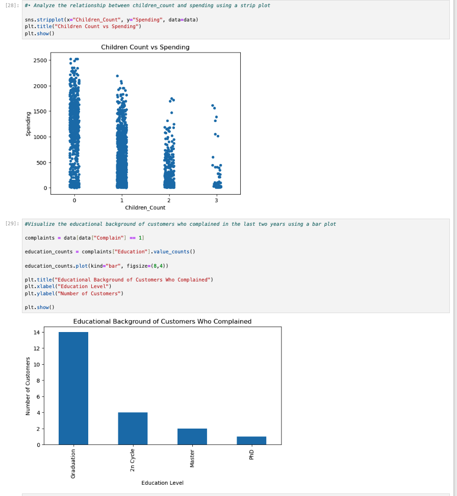

#### Income vs spending
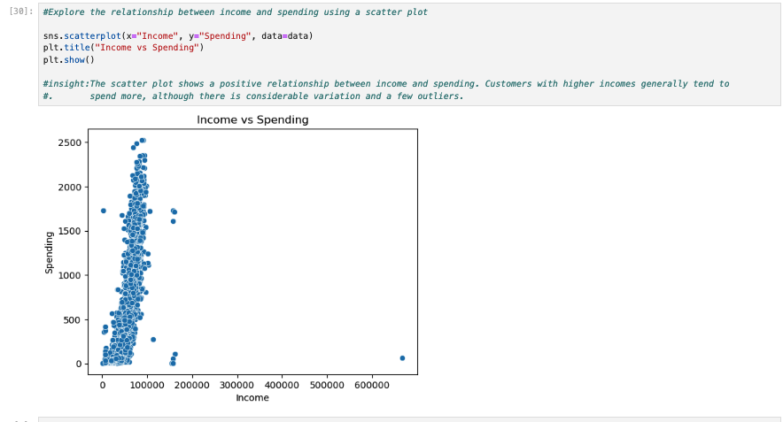

</details>

## 📁 Files

| File | Description |
|------|-------------|
| [`notebook/marketing_campaign_analysis.ipynb`](notebook/marketing_campaign_analysis.ipynb) | Full Jupyter Notebook with code, outputs, charts and interpretations (renders on GitHub) |
| [`docs/Marketing_Campaign_Report.docx`](docs/Marketing_Campaign_Report.docx) | Step-by-step project report |
| [`screenshots/`](screenshots/) | Notebook screenshots |

## ▶️ How to Run

```bash
pip install pandas numpy matplotlib seaborn scipy jupyter
jupyter notebook notebook/marketing_campaign_analysis.ipynb
```

Before running, change the path in the `pd.read_csv(...)` cell so it points to your copy of `marketing_data.csv`.

[← Back to portfolio](../../README.md)
