# Data Analyst Portfolio


Eight end-to-end data analysis projects built in **Power BI**, **Excel**, **SQL (MySQL)** and **Python**. Each one starts from raw data and ends with something a business can act on: an interactive dashboard, a database that answers business questions, a set of statistically tested insights, or a predictive model.

The projects follow the full analyst workflow:

**Raw data → Cleaning & ETL → Modeling → Calculations (DAX / formulas / SQL / pandas / statistics) → Visualization → Insights**

---

## Table of Contents

- [Projects at a Glance](#projects-at-a-glance)
- [Skills Demonstrated](#skills-demonstrated)
- **Power BI**
  - [Project 1: Zomato Restaurant Analytics](#project-1-zomato-restaurant-analytics)
  - [Project 2: Insurance Agency Performance](#project-2-insurance-agency-performance)
- **Excel**
  - [Project 3: E-Commerce Sales & Profit Dashboard](#project-3-e-commerce-sales--profit-dashboard)
  - [Project 4: Restaurant Tip Prediction](#project-4-restaurant-tip-prediction)
- **SQL**
  - [Project 5: Employee Performance Mapping](#project-5-employee-performance-mapping)
  - [Project 6: Air Cargo Analysis](#project-6-air-cargo-analysis)
- **Python**
  - [Project 7: Retail Sales Analysis](#project-7-retail-sales-analysis)
  - [Project 8: Marketing Campaign Analysis](#project-8-marketing-campaign-analysis)
- [Repository Structure](#repository-structure)
- [How to Open the Files](#how-to-open-the-files)

---

## Projects at a Glance

| # | Project | Tool | Domain | Data Scope | Highlights |
|---|---------|------|--------|-----------|-----------|
| 1 | [**Zomato Restaurant Analytics**](Power-BI/01-Zomato-Restaurant-Analytics/) | Power BI | Food delivery | ~8K restaurants, 6 continents, 140 cuisines | Merged 6 regional files, fixed encoding errors, unpivoted cuisines, star schema, conditional DAX rating color, 5 interactive pages |
| 2 | [**Insurance Agency Performance**](Power-BI/02-Insurance-Agency-Performance/) | Power BI | Insurance | ~2K agencies, $4.19bn premium, 2006–2015 | Measures table, `SWITCH`-driven dynamic measures, growth KPIs with `CALCULATE`, retention segmentation, 6 interactive pages |
| 3 | [**E-Commerce Sales & Profit Dashboard**](Excel/03-E-Commerce-Sales-Dashboard/) | Excel | Retail / E-commerce | 51,290 orders, 147 countries, $8.02M sales | Combo-box-driven dashboard using `INDEX` + `SUMIFS`, auto-expanding Excel Tables, combo charts. No VBA |
| 4 | [**Restaurant Tip Prediction**](Excel/04-Restaurant-Tip-Prediction/) | Excel | Hospitality / Predictive analytics | 244 transactions | Pivot-table EDA, dummy encoding, correlation-based feature selection, multiple linear regression, RMSE evaluation |
| 5 | [**Employee Performance Mapping**](SQL/05-Employee-Performance-Mapping/) | SQL (MySQL) | HR analytics | 3 tables: 19 employees, 13 data scientists, 6 projects | 17 queries: self-join, `UNION`, window functions (`RANK`, `MAX OVER`), view, stored procedure, user-defined function, index |
| 6 | [**Air Cargo Analysis**](SQL/06-Air-Cargo-Analysis/) | SQL (MySQL) | Aviation | 4 tables: 50 customers, 49 routes, 50 tickets, 50 flight records | 20 queries: `CHECK`/`UNIQUE` constraints, `ROLLUP`, window functions, views, procedures, a stored function, a cursor, `EXPLAIN ANALYZE`, user grants |
| 7 | [**Retail Sales Analysis**](Python/07-Retail-Sales-Analysis/) | Python | Retail | 7,560 transactions, Q4 2020 | pandas time-series slicing and resampling, `MinMaxScaler` normalization, descriptive statistics, box plots, state and group analysis |
| 8 | [**Marketing Campaign Analysis**](Python/08-Marketing-Campaign-Analysis/) | Python | Marketing | 2,240 customers, 28 variables | Group-wise imputation, feature engineering, IQR outlier capping, ordinal and one-hot encoding, correlation heatmap, 3 Welch's t-tests |

---

## Skills Demonstrated

| Area | What I did |
|------|-----------|
| **Data cleaning & ETL** | Power Query: fixed text encoding errors (`Sí£o Paulo` → `São Paulo`), applied Trim/Clean, removed blanks and duplicates, set data types, split and unpivoted columns, replaced values. Excel: validated that no values were missing |
| **Data integration** | Appended 6 continent-level tables into one fact table and mapped countries to continents |
| **Data modeling** | Built star schemas with one-to-many relationships. Created dimension tables, a dedicated `_Measures` table, and a disconnected helper table |
| **DAX** | `DISTINCTCOUNT`, `AVERAGE`, `SUM`, `CALCULATE`, `DIVIDE`, `SWITCH`, `DATATABLE`, calculated columns |
| **Excel formulas** | `SUMIFS`, `INDEX`, `IF`, `POWER`, `SQRT`, structured table references, pivot-table calculated fields |
| **SQL (MySQL)** | DDL with `CHECK`/`UNIQUE` constraints, joins (including self-joins), `UNION`, subqueries, `GROUP BY … HAVING`, `WITH ROLLUP`, window functions (`RANK`, `MAX OVER PARTITION BY`), `CASE`/`IF`, views, stored procedures with parameters, user-defined functions, cursors with handlers, indexes and `EXPLAIN ANALYZE`, user management (`CREATE USER`, `GRANT`) |
| **Python** | pandas (cleaning, `groupby`, `transform`, `resample`, date indexing), NumPy (`clip`), scikit-learn (`MinMaxScaler`), SciPy (`ttest_ind`), Matplotlib and Seaborn charts, Jupyter Notebooks |
| **Statistics** | Correlation analysis, multiple linear regression (Analysis ToolPak), p-values, adjusted R², RMSE, detecting multicollinearity (the dummy variable trap), Welch's t-tests, IQR outlier treatment, normalization |
| **Visualization** | KPI cards, maps, bar/column/combo charts, donut and pie charts, a treemap, line trends, scatter plots with trendlines, conditionally formatted tables, histograms, box plots, heatmaps, strip plots |
| **Interactivity & UX** | Slicers, cross-filtering, icon-based page navigation (Power BI Actions), Excel Form Control combo boxes |
| **Communication** | A written step-by-step report for every project, with insights and recommendations aimed at stakeholders |

---

# Power BI Projects

## Project 1: Zomato Restaurant Analytics

> **Business question:** Where does Zomato have restaurants, how are they rated, what do they cost, and which cuisines and services matter most?

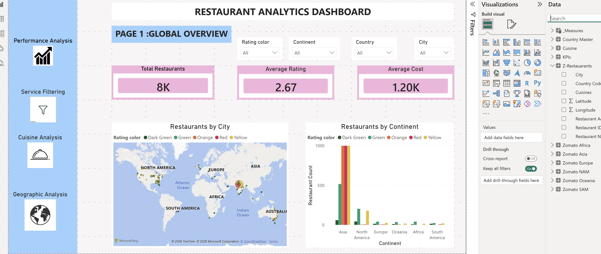

**Goal:** Combine restaurant data that was spread across six continent-level Excel files into one interactive dashboard. Users can drill from **continent → country → city** and find the highest-rated restaurants, the lowest-cost restaurants, popular cuisines and service patterns.

### Key Insights

- **~8K restaurants** analyzed, with an **average rating of 2.67** across all regions.
- **Asia dominates the dataset.** India is the top country and New Delhi is the top city by restaurant count.
- **North Indian, Chinese and Fast Food** are the most common of **140 distinct cuisines**.
- **88% of restaurants don't offer table booking and 75% don't offer online delivery.** Restaurants that do offer these services have noticeably **higher average ratings**.

### Dashboard Pages

| Page | What it shows | Key functionality |
|------|---------------|-------------------|
| **1. Global Overview** | KPI cards, restaurant map, restaurants by continent | Continent, Country, City and Rating Color slicers. Icon navigation to every page |
| **2. Performance Analysis** | Top 10 restaurants by rating, Top 10 lowest cost, performance table | Top N filtering. Data bars on rating |
| **3. Service Filtering** | Table booking and online delivery share, rating by service | Service slicers that cross-filter all visuals |
| **4. Cuisine Analysis** | Top 10 cuisines, full cuisine treemap, Cuisine Count | Built on an unpivoted Cuisine dimension table |
| **5. Geographic Analysis** | Top countries and cities, average cost and rating by country | Country and city comparisons |

<details>
<summary><b>📸 View all Zomato pages, the data model and the ETL steps</b></summary>

#### Page 2: Performance Analysis
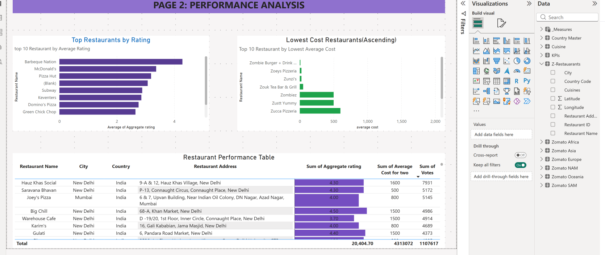

#### Page 3: Service Filtering
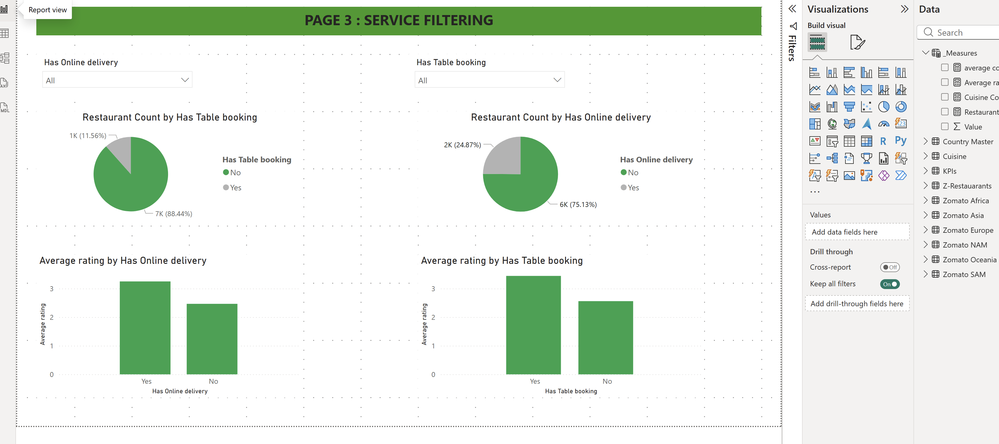

#### Page 4: Cuisine Analysis
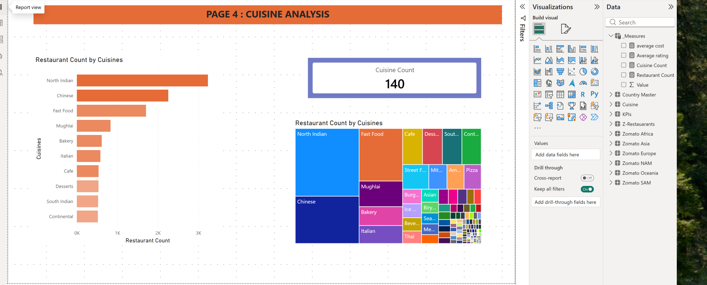

#### Page 5: Geographic Analysis
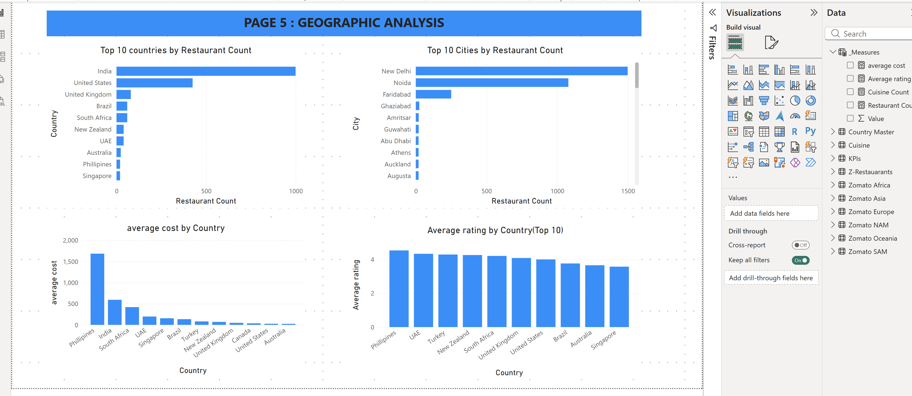

#### Data Model (Star Schema)
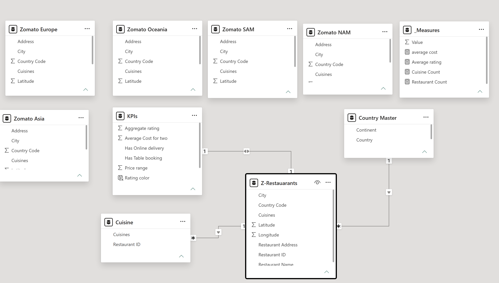

#### Power Query: ETL & Data Cleaning
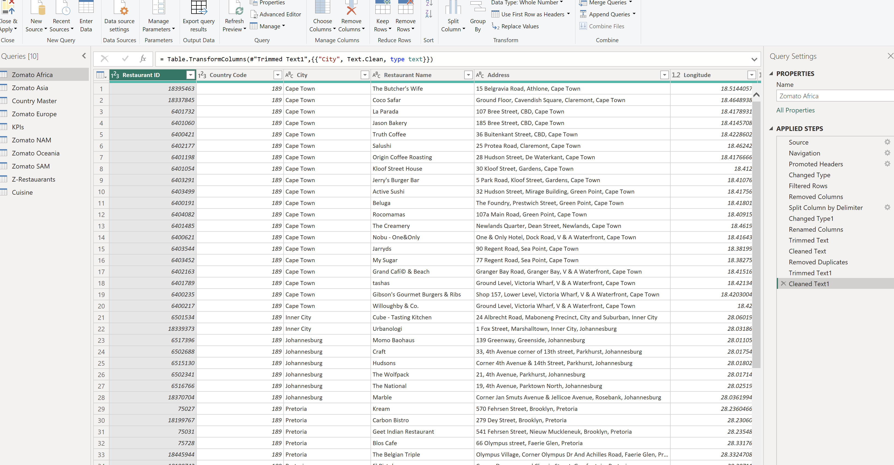

</details>

➡️ **[Full write-up: ETL, data model, DAX and page walkthrough](Power-BI/01-Zomato-Restaurant-Analytics/)**

---

## Project 2: Insurance Agency Performance

> **Business question:** Which agencies, products, quoting systems and states drive premium, retention and conversion, and how has the business grown?

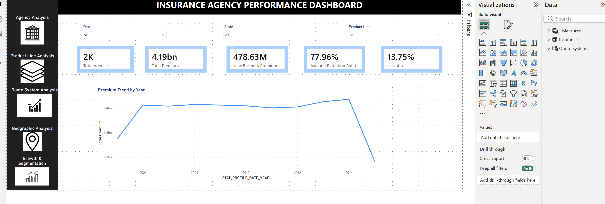

**Goal:** Analyze insurance agency performance from 2006 to 2015 across agencies, product lines (Commercial vs Personal), quoting systems and states, to support decisions on retention, sales conversion and growth.

### Key Insights

- **$4.19bn total earned premium** across **~2K agencies**, including **$478.63M of new business**. Average retention is **77.96%** and the hit ratio is **13.75%**.
- **Personal Lines contribute 58.8% of premium**, and **Ohio** produces the most premium by a wide margin.
- **eQT converts best** (~78% hit ratio). **PLRANK** handles the most quotes (24M) but binds only ~1M of them.
- Premium grew only **3.31%** from 2006 to 2013, and about a third of agencies fall in the **low-retention** segment.

### Dashboard Pages

| Page | What it shows | Key functionality |
|------|---------------|-------------------|
| **1. Executive Overview** | 5 KPI cards and the premium trend by year | Year, State and Product Line slicers. Icon navigation |
| **2. Agency Analysis** | Top 10 agencies by retention and by premium, detail table | Top N filtering. Banded table |
| **3. Product Line Analysis** | Commercial vs Personal Lines on 4 metrics | Side-by-side comparison |
| **4. Quote System Analysis** | Hit ratio by quote system, quotes vs bound policies | `SWITCH`-based dynamic measures |
| **5. Geographic Analysis** | Premium and retention by state, bubble map | Top N filtering. Map |
| **6. Growth & Segmentation** | Retention segments, loss ratio trend, growth KPIs | Time-bound `CALCULATE` measures |

<details>
<summary><b>📸 View all Insurance pages and the ETL steps</b></summary>

#### Page 2: Agency Analysis
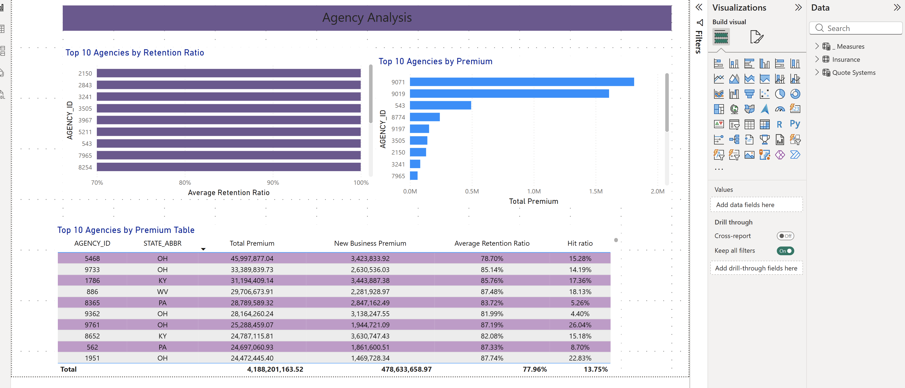

#### Page 3: Product Line Analysis
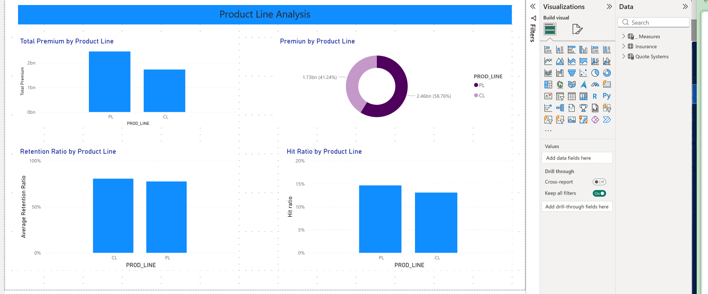

#### Page 4: Quote System Analysis
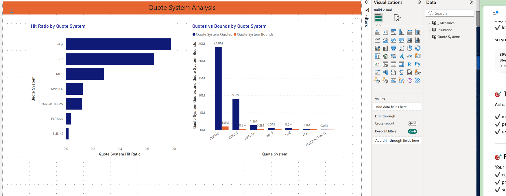

#### Page 5: Geographic Analysis
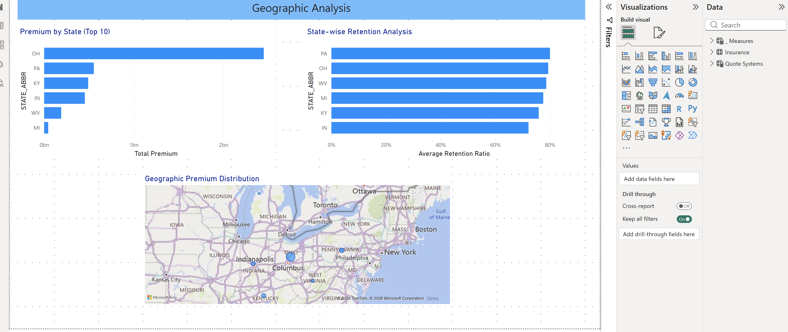

#### Page 6: Growth & Segmentation
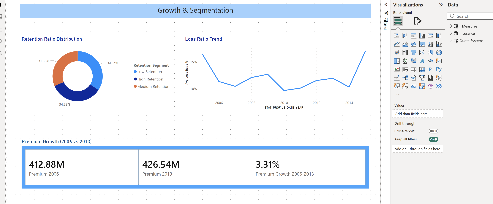

#### Power Query: ETL & Data Cleaning
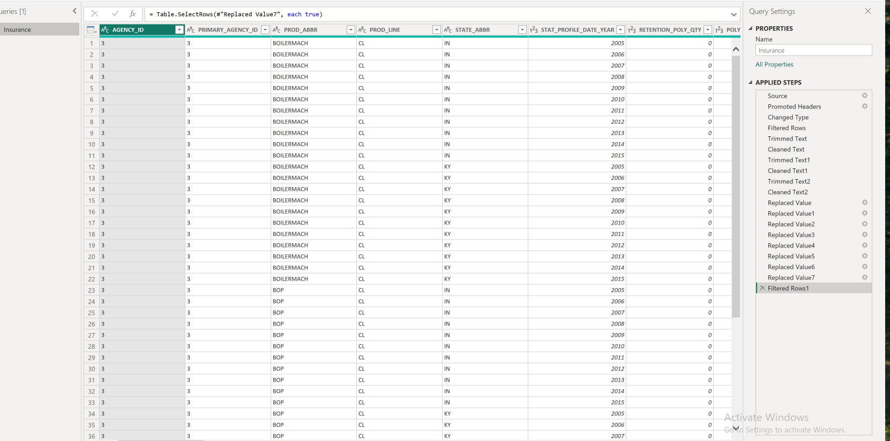

</details>

➡️ **[Full write-up: ETL, DAX measures and page walkthrough](Power-BI/02-Insurance-Agency-Performance/)**

---

# Excel Projects

## Project 3: E-Commerce Sales & Profit Dashboard

> **Business question:** How do sales and profit trend through the year, which regions perform best, and how does this change by product category?

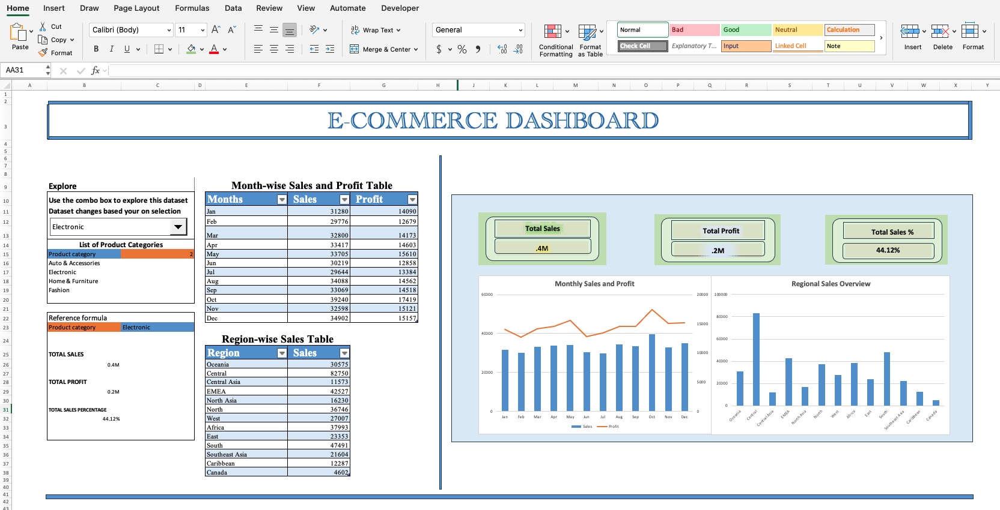

**Goal:** Turn 51,290 raw orders into a one-page interactive Excel dashboard. A single **combo box** recalculates every KPI, table and chart for the selected product category, using `INDEX` + `SUMIFS` on an auto-expanding Excel Table.

### Key Insights

- **$8.02M sales** and **$3.73M profit**, a **46.5% profit margin** for 2015.
- **Fashion makes up 65% of revenue**, followed by Home & Furniture (16%), Auto & Accessories (14%) and Electronic (5%).
- **Central is the largest region** ($1.74M), followed by South and EMEA. Sales are steady across the year with a **small Q4 peak**.

<details>
<summary><b>📸 View the source data table</b></summary>

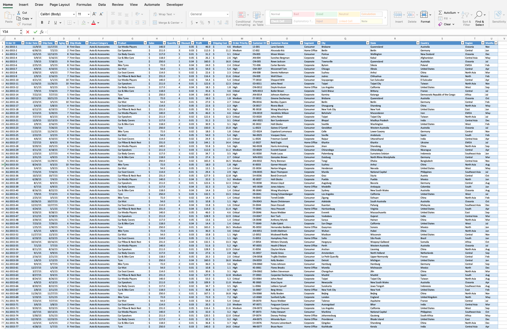

</details>

➡️ **[Full write-up: formulas, build steps and dashboard walkthrough](Excel/03-E-Commerce-Sales-Dashboard/)**

---

## Project 4: Restaurant Tip Prediction

> **Business question:** What drives how much customers tip, and can we predict it?

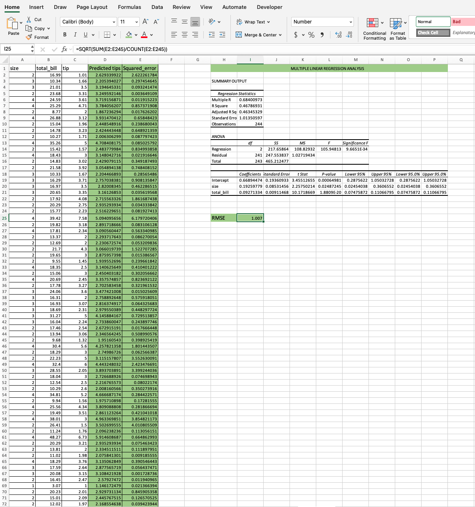

**Goal:** Explore 244 restaurant transactions with pivot tables, encode the categorical variables, choose predictors through correlation analysis, and build a **multiple linear regression model** in Excel to predict tips.

**Final model:** `Predicted Tip = 0.6689 + 0.1926 × size + 0.0927 × total_bill`, with **Adjusted R² = 0.463** and **RMSE = $1.01**

### Key Insights

- **The bill amount is the strongest predictor** (r = 0.68). Each extra $10 on the bill adds about $0.93 to the tip.
- **Each extra guest adds about $0.19.** Gender, smoking status, day and time have **no significant effect**.
- **The 2-variable model is better than the 9-variable model** (higher adjusted R²). Building the larger model also exposed the **dummy variable trap**, a multicollinearity problem.

<details>
<summary><b>📸 View the encoding, EDA, correlation and regression sheets</b></summary>

#### Dataset & Categorical Encoding
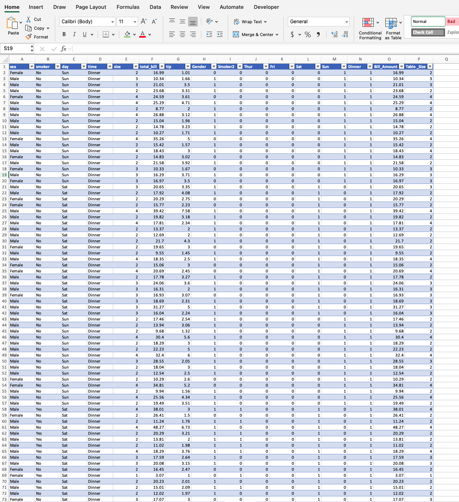

#### Exploratory Analysis: Pivot Tables & Charts
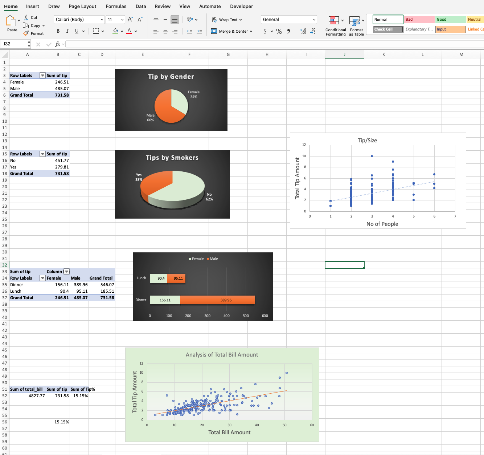

#### Correlation Matrix
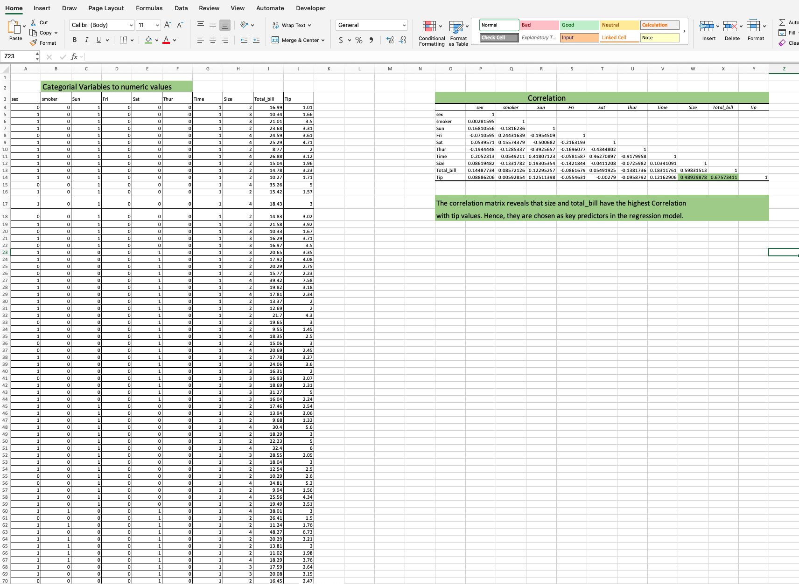

#### Full Regression Model (9 predictors)
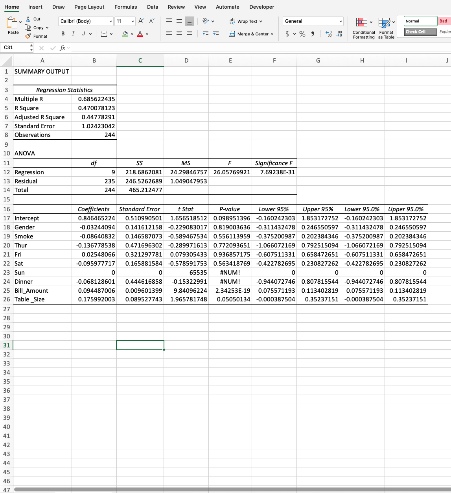

</details>

➡️ **[Full write-up: EDA, feature selection, regression and RMSE](Excel/04-Restaurant-Tip-Prediction/)**

---

# SQL Projects

## Project 5: Employee Performance Mapping

> **Business question:** How are employees performing, how are they paid, and do data scientists' job titles match the company's experience standard?

**Goal:** Build an `employee` database in MySQL from three CSV files (employee records, the data science team and projects), then write 17 queries covering ratings, reporting lines, salaries, experience rankings, bonuses and job-title validation.

```sql
-- Each employee's rating next to the best rating in their department
SELECT EMP_ID, FIRST_NAME, LAST_NAME, ROLE, DEPT, EMP_RATING,
       MAX(EMP_RATING) OVER (PARTITION BY DEPT) AS maximum_Dept_rating
FROM emp_record_table;
```

### Key Insights

- **All 13 data scientists hold the title that the experience standard expects.** A user-defined function with `IF / ELSEIF` logic was used to check this.
- **12 of 19 employees earn more than 6,000** (saved as the `RICH_EMP` view), and **8 have more than 10 years of experience**.
- **Retail is the largest department** (7 employees). Staff are spread across **7 countries**.

➡️ **[Full write-up: every query, techniques and findings](SQL/05-Employee-Performance-Mapping/)**

---

## Project 6: Air Cargo Analysis

> **Business question:** Who are the customers, how much revenue does each ticket class generate, and how should routes be classified?

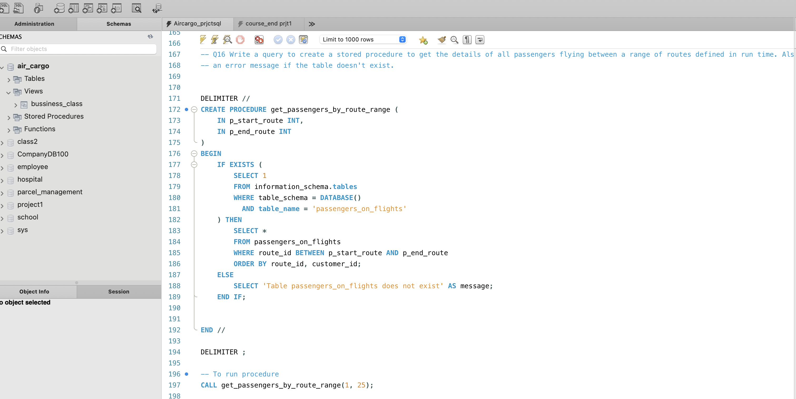

**Goal:** Build an `air_cargo` database in MySQL from 4 airline tables and answer 20 business questions. The work covers schema design, analysis, reusable logic (views, procedures, a function, a cursor), performance tuning and user administration.

### Key Insights

- **Business class brings in 39% of ticket revenue** (6,034 of 15,369) from about a quarter of the bookings. Total revenue passed the 10,000 target.
- **33 of 50 registered customers have booked a ticket.** Emirates is the most frequent airline brand (18 of 50 tickets).
- **The network is mostly short and medium haul:** 25 short, 21 intermediate and only 3 long-distance routes.

➡️ **[Full write-up: all 20 queries, screenshots and findings](SQL/06-Air-Cargo-Analysis/)**

---

# Python Projects

## Project 7: Retail Sales Analysis

> **Business question:** How did sales move across Q4 2020, and which months, states and customer groups drive revenue?

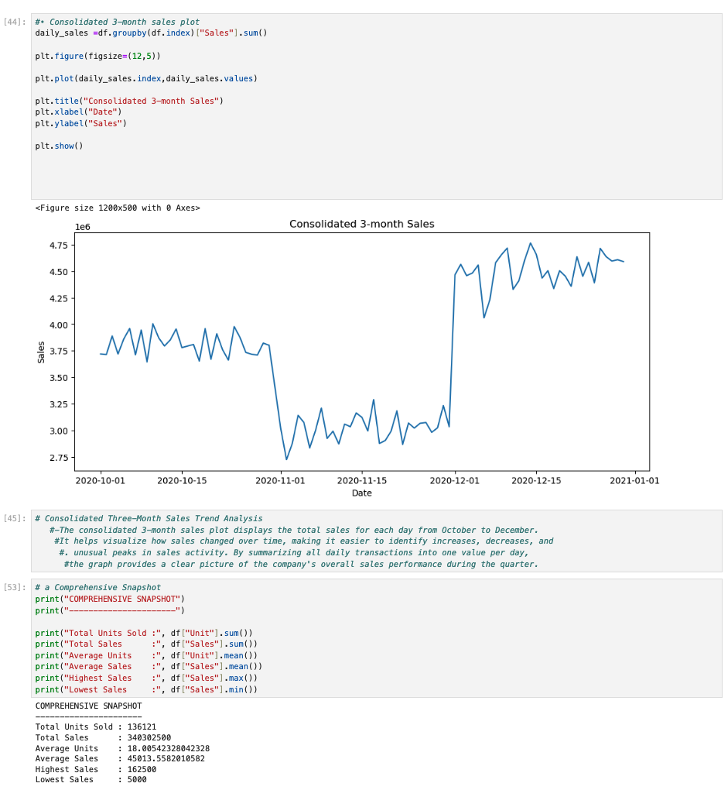

**Goal:** Analyze 7,560 transactions (October–December 2020) in a Jupyter Notebook. The analysis uses pandas date indexing and resampling, normalization, descriptive statistics, box plots and state and customer-group breakdowns.

### Key Insights

- **340.3M in sales and 136,121 units** for the quarter.
- **December was the best month** (135.3M, **49% above November**). **November was the weakest** (90.7M), with daily sales dropping sharply on 1 November and recovering on 1 December.
- **KY is the top state**, followed by NY and FL. WA, AZ and TX are the lowest. Sales are **split almost evenly** across Kids, Men, Women and Seniors.

➡️ **[Full write-up: steps, monthly breakdown and charts](Python/07-Retail-Sales-Analysis/)**

---

## Project 8: Marketing Campaign Analysis

> **Business question:** What drives customer spending, and who responds to marketing campaigns?


**Goal:** Clean and enrich a 2,240-customer marketing dataset, then use correlation analysis and hypothesis testing to find what drives spending and campaign response.

### Key Insights

- **Campaign responders spend more and earn more.** Both differences are significant in Welch's t-tests (p < 0.001).
- **Customers with children spend significantly less** (r = −0.50 between children count and spending). Income is the strongest driver of spending (r = 0.66).
- **Wine (680,816) and meat (373,968) lead product spending.** **Spain** had by far the most customers who accepted the last campaign.

➡️ **[Full write-up: cleaning, feature engineering, tests and charts](Python/08-Marketing-Campaign-Analysis/)**

---

## Repository Structure

```
.
├── README.md                                   ← You are here (portfolio overview)
│
├── Power-BI/
│   ├── 01-Zomato-Restaurant-Analytics/
│   │   ├── README.md                           ← Detailed project write-up
│   │   ├── report/      Zomato_Restaurant_Analytics.pbix
│   │   ├── docs/        Zomato_Project_Report.docx
│   │   └── screenshots/ Report pages, data model, Power Query
│   │
│   └── 02-Insurance-Agency-Performance/
│       ├── README.md
│       ├── report/      Insurance_Agency_Performance.pbix
│       ├── docs/        Insurance_Agency_Project_Report.docx
│       ├── screenshots/ Report pages, Power Query
│       └── assets/      Navigation icons
│
├── Excel/
│   ├── 03-E-Commerce-Sales-Dashboard/
│   │   ├── README.md
│   │   ├── workbook/    E-Commerce_Dashboard.xlsx      (finished dashboard)
│   │   ├── data/        E-Commerce_Sales_Data_raw.xlsx (raw data)
│   │   ├── docs/        Project report (PDF + Word)
│   │   └── screenshots/
│   │
│   └── 04-Restaurant-Tip-Prediction/
│       ├── README.md
│       ├── data/        Restaurant_Tips_Dataset.xlsx
│       ├── docs/        Project report (PDF + Word)
│       └── screenshots/ Encoding, EDA, correlation, regression, prediction
│
├── SQL/
│   ├── 05-Employee-Performance-Mapping/
│   │   ├── README.md
│   │   ├── sql/         employee_performance_mapping.sql
│   │   └── data/        emp_record_table, data_science_team, proj_table (CSV)
│   │
│   └── 06-Air-Cargo-Analysis/
│       ├── README.md
│       ├── sql/         air_cargo_analysis.sql
│       ├── data/        customer, routes, passengers_on_flights, ticket_details (CSV)
│       ├── docs/        Air_Cargo_Project_Report.docx
│       └── screenshots/ MySQL Workbench queries Q1–Q20
│
└── Python/
    ├── 07-Retail-Sales-Analysis/
    │   ├── README.md
    │   ├── notebook/    sales_analysis.ipynb
    │   ├── docs/        Sales_Analysis_Report.docx
    │   └── screenshots/ Notebook outputs and charts
    │
    └── 08-Marketing-Campaign-Analysis/
        ├── README.md
        ├── notebook/    marketing_campaign_analysis.ipynb
        ├── docs/        Marketing_Campaign_Report.docx
        └── screenshots/ Notebook outputs and charts
```

---

## How to Open the Files

| File type | How to open |
|-----------|-------------|
| `.pbix` (Power BI) | Install the free [Power BI Desktop](https://powerbi.microsoft.com/desktop/) (Windows) and open the file. The data is stored in the model, so every visual, slicer and navigation button works offline |
| `.xlsx` (Excel) | Open in desktop Microsoft Excel. The E-Commerce combo box requires desktop Excel, not Excel Online |
| `.sql` (SQL) | Viewable directly on GitHub. To run: open in MySQL Workbench, import the CSVs from the project's `data/` folder, then run the queries |
| `.ipynb` (Python) | GitHub renders the notebooks with all code, outputs and charts. To run: `pip install pandas numpy matplotlib seaborn scipy scikit-learn jupyter` |
| `.pdf` reports | Viewable directly on GitHub |

> Every page and analysis step is also shown in the screenshots above and in each project's README.

---

## Contact

I'm a data analyst who enjoys turning messy data into clear, decision-ready insights. I'm open to data analyst and BI roles. Feel free to reach out!
