# ✈️ Air Cargo Analysis (SQL)


[← Back to portfolio](../../README.md)


---

## 📌 Project Overview

I built an `air_cargo` database in **MySQL** from four airline CSV files and answered **20 business questions** about passengers, tickets, revenue and routes.

The project covers the whole range of SQL work an analyst does:

- **Database design:** an ER diagram and a new table with constraints
- **Analysis:** joins, aggregation, `HAVING`, `IF`, `ROLLUP` and window functions
- **Reusable logic:** views, stored procedures, a stored function and a cursor
- **Administration and performance:** creating a user, granting access, indexing and reading the execution plan

## 🎯 Business Questions

- Who are the regular customers, and which ones booked a ticket?
- How many passengers fly Business class, and how much revenue does it bring in?
- Has total ticket revenue passed 10,000?
- Which routes are short, intermediate or long distance?
- Which ticket classes come with complimentary services?

## 📂 Dataset

| Table | Rows | Key columns |
|-------|------|-------------|
| [`customer`](data/customer.csv) | 50 | customer_id, first_name, last_name, date_of_birth, gender |
| [`routes`](data/routes.csv) | 49 | route_id, flight_num, origin_airport, destination_airport, aircraft_id, distance_miles |
| [`passengers_on_flights`](data/passengers_on_flights.csv) | 50 | customer_id, aircraft_id, route_id, depart, arrival, seat_num, class_id, travel_date, flight_num |
| [`ticket_details`](data/ticket_details.csv) | 50 | p_date, customer_id, aircraft_id, class_id, no_of_tickets, a_code, Price_per_ticket, brand |

**ER relationships:** `customer` 1 : M `passengers_on_flights`, `customer` 1 : M `ticket_details`, `routes` 1 : M `passengers_on_flights`.

> **Data-quality note:** the source data spells the class as `'Bussiness'`, so the queries filter on that exact spelling. British Airways is also inconsistent: 9 of its 10 ticket records say `'Bristish Airways'`. Cleaning that value would be needed before any brand-level analysis.

---

## 🔧 What Each Query Does

| # | Task | SQL techniques |
|---|------|----------------|
| Q1 | ER diagram for the airline database | Entities, PK/FK relationships |
| Q2 | Create `route_details` with valid flight numbers, unique route IDs and distance > 0 | `CREATE TABLE`, `UNIQUE`, `CHECK` constraints |
| Q3 | Passengers on routes 1–25 | `BETWEEN`, `ORDER BY` |
| Q4 | Number of Business-class passengers and the revenue they generate | `COUNT`, `SUM(price × tickets)` |
| Q5 | Customer full names | `CONCAT` |
| Q6 | Customers who registered **and** booked a ticket | `INNER JOIN` |
| Q7 | Customers who flew with Emirates | `JOIN` + `WHERE` |
| Q8 | Customers who travelled in Economy Plus | `GROUP BY` + `HAVING` |
| Q9 | Has total revenue passed 10,000? | `IF()` on an aggregate |
| Q10 | Create a new user and give it access to the database | `CREATE USER`, `GRANT`, `FLUSH PRIVILEGES` |
| Q11 | Highest ticket price in each class | `MAX() OVER (PARTITION BY class_id)` |
| Q12 | Faster lookup of passengers on route 4 | `CREATE INDEX` |
| Q13 | Execution plan for that lookup | `EXPLAIN ANALYZE` |
| Q14 | Ticket spend by customer and aircraft, with subtotals | `GROUP BY … WITH ROLLUP` |
| Q15 | View of Business-class customers and their airline | `CREATE VIEW` |
| Q16 | Passengers within a route range chosen at runtime, with an error message if the table is missing | **Stored procedure** with `IN` parameters + `information_schema` check |
| Q17 | Routes longer than 2,000 miles | Stored procedure |
| Q18 | Group routes into SDT (≤ 2,000 mi), IDT (2,001–6,500 mi) and LDT (> 6,500 mi) | Stored procedure + `CASE` |
| Q19 | Mark which tickets include complimentary services (Business and Economy Plus) | **Stored function** called inside a stored procedure |
| Q20 | First customer whose last name ends in "Scott" | **Cursor** + `CONTINUE HANDLER FOR NOT FOUND` |

### Highlighted Queries

**Runtime route range with a table-exists check (Q16)**

```sql
CREATE PROCEDURE get_passengers_by_route_range (IN p_start_route INT, IN p_end_route INT)
BEGIN
  IF EXISTS (SELECT 1 FROM information_schema.tables
             WHERE table_schema = DATABASE() AND table_name = 'passengers_on_flights') THEN
     SELECT * FROM passengers_on_flights
     WHERE route_id BETWEEN p_start_route AND p_end_route
     ORDER BY route_id, customer_id;
  ELSE
     SELECT 'Table passengers_on_flights does not exist' AS message;
  END IF;
END
```

**Subtotals with ROLLUP (Q14)**

```sql
SELECT customer_id, aircraft_id,
       SUM(no_of_tickets * Price_per_ticket) AS Total_price_tickects
FROM ticket_details
GROUP BY customer_id, aircraft_id WITH ROLLUP;
```

---

## 💡 Key Findings

*These figures were calculated directly from the CSV files in [`data/`](data/).*

1. **Business class: 13 ticket records and 6,034 in revenue** (Q4). That is **39%** of the total ticket revenue of **15,369**, from a quarter of the bookings.
2. **Total revenue passed the 10,000 threshold** (Q9).
3. **33 of the 50 registered customers have booked a ticket** (Q6), and **9 customers** have flown Economy Plus (Q8).
4. **The route network is mostly short and medium haul:** 25 SDT routes, 21 IDT and only 3 LDT (Q18). 24 routes are longer than 2,000 miles (Q17).
5. **Emirates is the most frequent brand**, with 18 of the 50 ticket records (Q7).
6. The cursor in Q20 returns **Samuel Scott (customer 37)**, the first of two customers with the last name Scott.

## 📸 Screenshots

All queries were written and run in **MySQL Workbench**.

<details>
<summary><b>View the query screenshots</b></summary>

| Screenshot | Questions |
|------------|-----------|
| 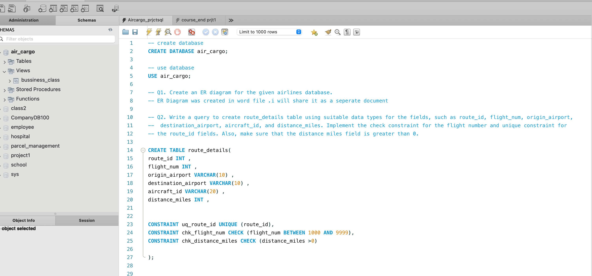 | Q1–Q2: Database setup and `route_details` with constraints |
| 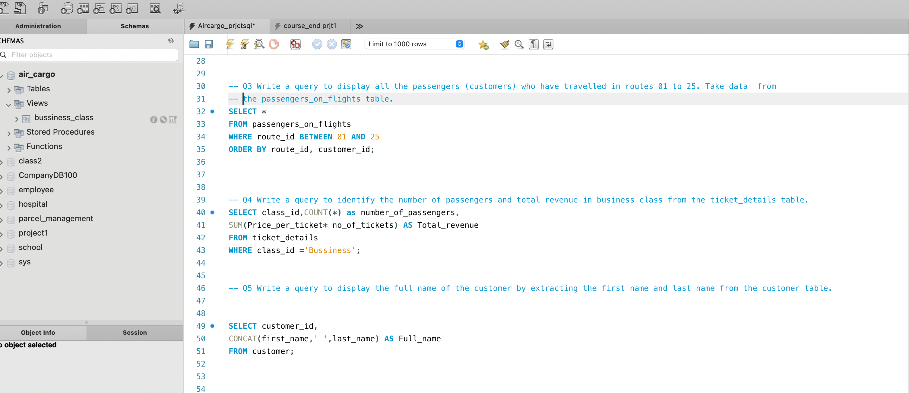 | Q3–Q5: Route filter, Business-class revenue, full names |
| 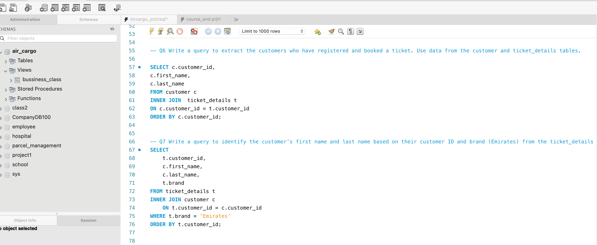 | Q6–Q7: Joins |
| 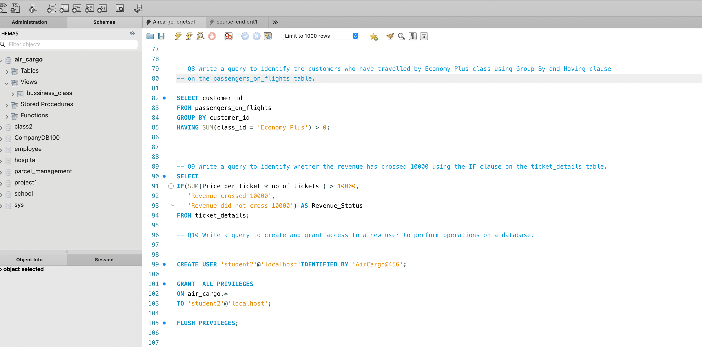 | Q8–Q10: `HAVING`, `IF`, user and grants |
| 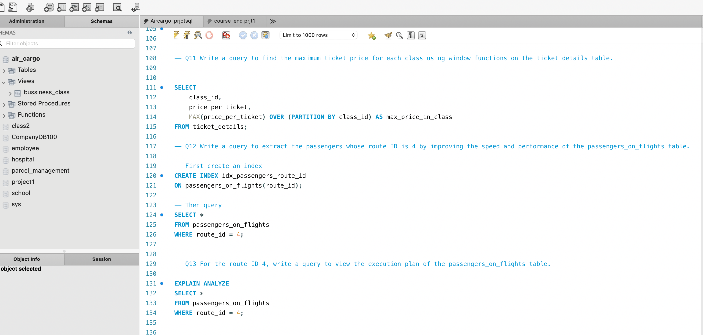 | Q11–Q13: Window function, index, `EXPLAIN ANALYZE` |
| 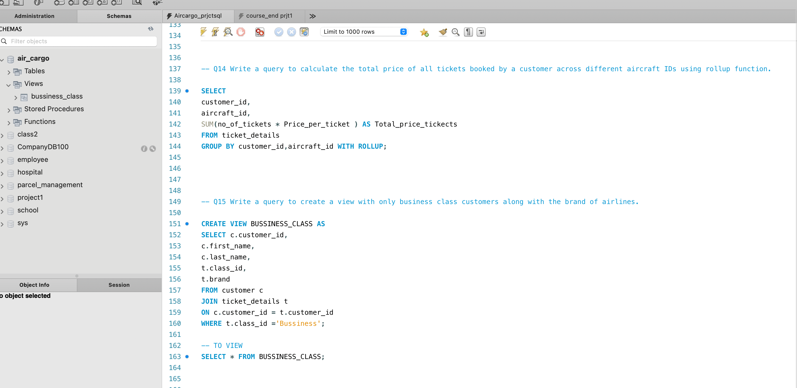 | Q14–Q15: `ROLLUP` and view |
|  | Q16: Procedure with runtime parameters |
| 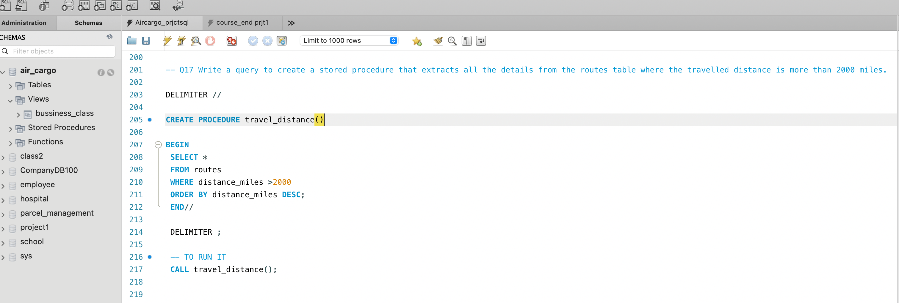 | Q17: Long-distance routes procedure |
| 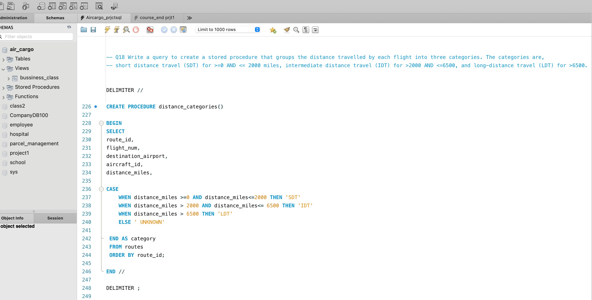 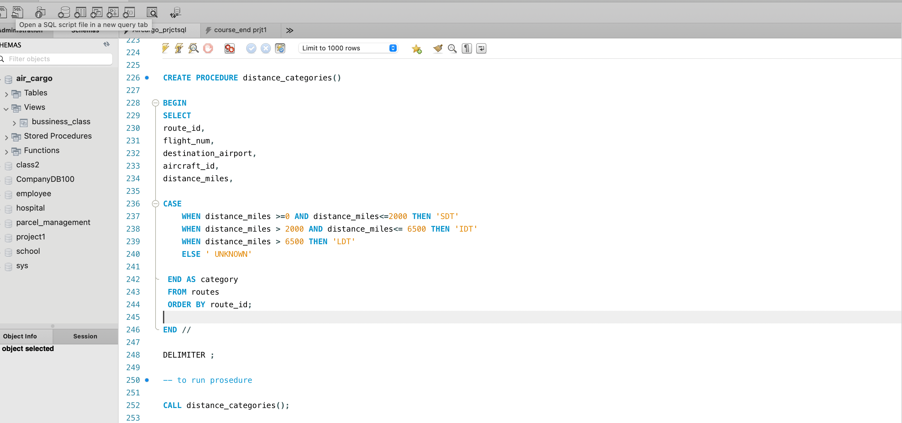 | Q18: Distance categories |
| 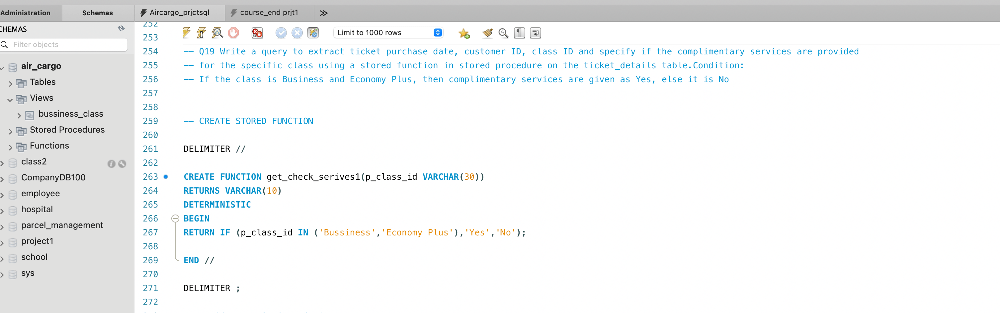 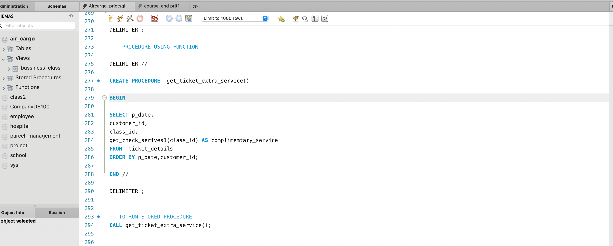 | Q19: Stored function inside a procedure |
| 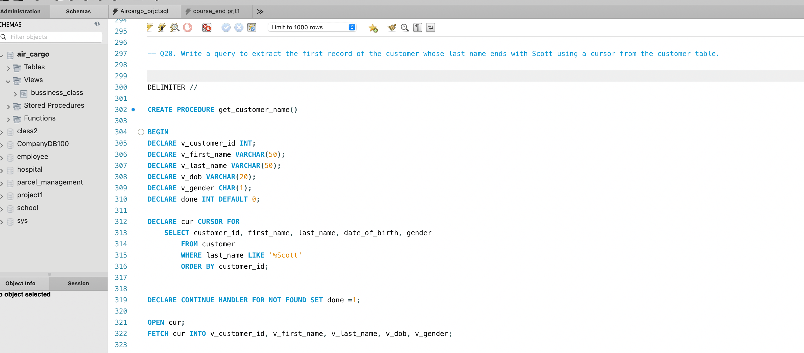 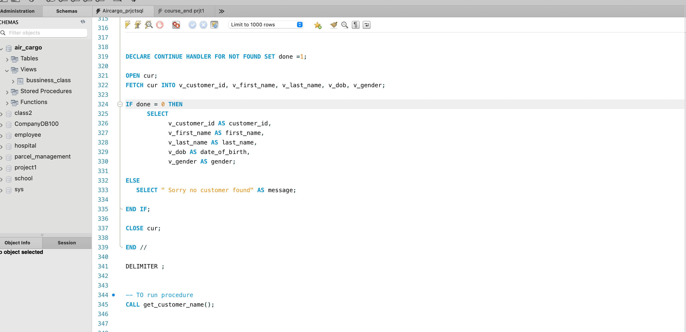 | Q20: Cursor |

</details>

## 📁 Files

| File | Description |
|------|-------------|
| [`sql/air_cargo_analysis.sql`](sql/air_cargo_analysis.sql) | Full script with all 20 questions, commented |
| [`data/`](data/) | The 4 source CSV files |
| [`docs/Air_Cargo_Project_Report.docx`](docs/Air_Cargo_Project_Report.docx) | Report with every question, the SQL used and an explanation of how it works |
| [`screenshots/`](screenshots/) | MySQL Workbench screenshots |

## ▶️ How to Run

1. Open the script in **MySQL Workbench** and run `CREATE DATABASE air_cargo; USE air_cargo;`.
2. Import the 4 CSVs from [`data/`](data/) with the *Table Data Import Wizard*. Keep the file names as table names.
3. Run each query in turn. Run the procedure, function and cursor blocks whole, including their `DELIMITER` lines.

[← Back to portfolio](../../README.md)
